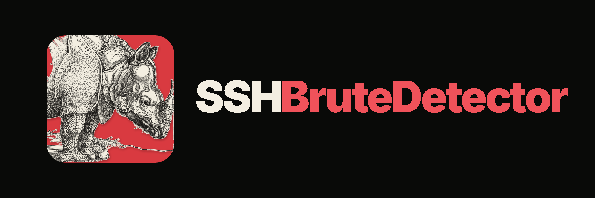
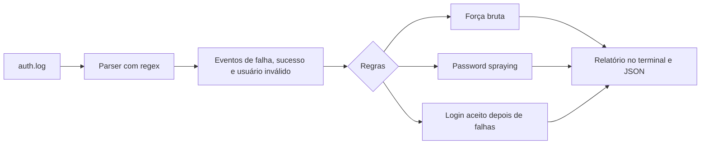

<p align="center"><sub>SSH Brute Detector</sub></p>

---

<p align="center">
  
</p>

<p align="center">
  Analisa o auth.log e detecta força bruta, password spraying e logins suspeitos com MITRE ATT&CK
</p>

<p align="center">
  
  
  
  <a href="https://github.com/arthurlynow098/ssh-brute-detector/actions/workflows/testes.yml"></a>
</p>

## Sobre o projeto

Qualquer servidor Linux com a porta 22 aberta na internet começa a receber tentativa de login em minutos. Eu queria entender como um analista de SOC enxerga isso, então montei uma ferramenta que lê o `auth.log`, separa o que é ruído do que é ataque e gera alertas já mapeados no **MITRE ATT&CK**.

É o tipo de coisa que um SIEM faz em escala. Aqui eu fiz na mão para entender cada regra.

## Como funciona



## Tecnologias

<p>
  
  
  
</p>

## Executando o código

Só precisa de Python 3.10 ou mais novo. O repositório já vem com um log de laboratório em `exemplos/auth.log`, gerado pelo script `exemplos/gerar_log.py` com IPs reservados para documentação.

```bash
git clone https://github.com/arthurlynow098/ssh-brute-detector.git
cd ssh-brute-detector

# roda no log de exemplo
python -m sshdetector exemplos/auth.log --ano 2026

# num servidor de verdade, com sugestão de bloqueio e relatório em JSON
sudo python -m sshdetector /var/log/auth.log --bloqueio --json relatorio.json

# ajustando a sensibilidade
python -m sshdetector exemplos/auth.log --limite 10 --janela 5
```

Testes

```bash
pip install -r requirements-dev.txt
python -m pytest -q
```

## Exemplo

```text
  27 eventos lidos, 25 falhas e 2 logins aceitos

  IPs que mais falharam
    203.0.113.45      12
    203.0.113.99      7
    198.51.100.77     6

  4 alerta(s)
  !!  [alta] 203.0.113.45 5 falhas em menos de 10 min (T1110.001 Password Guessing)
  !   [media] 198.51.100.77 tentou 4 usuários diferentes (T1110.003 Password Spraying)
  !!  [alta] 203.0.113.99 5 falhas em menos de 10 min (T1110.001 Password Guessing)
  !!! [critica] 203.0.113.99 login de deploy aceito depois de 7 falhas (T1078 Valid Accounts)

  Sugestão de bloqueio, revise antes de aplicar
    sudo ufw deny from 198.51.100.77
    sudo ufw deny from 203.0.113.45
    sudo ufw deny from 203.0.113.99
```

## Estudei por aqui

Segui essas aulas e materiais para entender e aplicar tudo que está aqui.

| Material | O que tirei dele |
|---|---|
| [TryHackMe, Intro to Logs](https://tryhackme.com/room/introtologs) | Tipos de log, onde ficam e como ler com olhar de analista |
| [MITRE ATT&CK T1110, Brute Force](https://attack.mitre.org/techniques/T1110/) | As subtécnicas de força bruta e como detectar cada uma |
| [OWASP Authentication Cheat Sheet](https://cheatsheetseries.owasp.org/cheatsheets/Authentication_Cheat_Sheet.html) | Bloqueio de conta, limite de tentativas e o lado de quem defende |
| [Curso em Vídeo, Python Mundo 1](https://www.youtube.com/playlist?list=PLHz_AreHm4dlKP6QQCekuIPky1CiwmdI6) | Base de Python que usei em todos os projetos |

## Licença

Distribuído sob a licença MIT. Veja o arquivo [LICENSE](LICENSE).

<p align="center"><sub>A gravura do banner é o rinoceronte de Albrecht Dürer, de 1515, em domínio público no <a href="https://commons.wikimedia.org/wiki/File%3AThe_Rhinoceros_MET_MM2134.jpg">Wikimedia Commons</a>.</sub></p>
