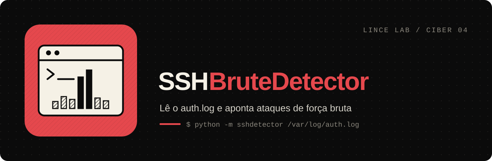
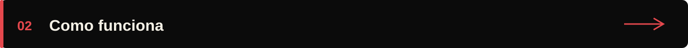
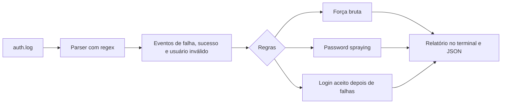

<a id="top"></a>

<p align="center"></p>

<p align="center">


<a href="https://github.com/arthurlynow098/ssh-brute-detector/actions/workflows/testes.yml"></a>
</p>

<p align="center"><a href="#sobre">Sobre</a> &nbsp;&nbsp; <a href="#como-funciona">Como funciona</a> &nbsp;&nbsp; <a href="#rodando">Rodando</a> &nbsp;&nbsp; <a href="#aprendi">O que aprendi</a> &nbsp;&nbsp; <a href="#estudos">Estudos</a></p>

<a id="sobre"></a>

<p></p>

Qualquer servidor Linux com a porta 22 aberta na internet começa a receber tentativa de login em minutos. Eu queria entender como um analista de SOC enxerga isso, então montei uma ferramenta que lê o `auth.log`, separa o que é ruído do que é ataque e gera alertas já mapeados no **MITRE ATT&CK**.

É o tipo de coisa que um SIEM faz em escala. Aqui eu fiz na mão para entender cada regra.

<a id="como-funciona"></a>

<p></p>



| Regra | Quando dispara | Severidade | MITRE |
|---|---|---|---|
| Força bruta | 5 falhas do mesmo IP dentro de 10 minutos (janela deslizante) | alta | T1110.001 |
| Password spraying | O mesmo IP tentando 4 usuários diferentes ou mais | média | T1110.003 |
| Acesso suspeito | Login aceito vindo de um IP que já tinha falhado várias vezes | **crítica** | T1078 |

Algumas escolhas que fiz

- **Janela deslizante em vez de contagem total.** Contar o dia inteiro esconde rajadas curtas e também gera falso positivo para quem erra a senha algumas vezes ao longo do dia.
- **A regra de acesso suspeito é a mais importante.** Mil tentativas bloqueadas são só barulho. Uma tentativa que deu certo depois de mil é incidente.
- **Código de saída 1 quando tem alerta crítico.** Assim dá para usar o script num cron ou pipeline e disparar uma notificação.

<a id="rodando"></a>

<p></p>

Só precisa de Python 3.10 ou mais novo. O repositório já vem com um log de laboratório em `exemplos/auth.log`, gerado pelo script `exemplos/gerar_log.py` com IPs reservados para documentação.

```bash
git clone https://github.com/arthurlynow098/ssh-brute-detector.git
cd ssh-brute-detector

# roda no log de exemplo
python -m sshdetector exemplos/auth.log --ano 2026

# num servidor de verdade, com sugestão de bloqueio e relatório em JSON
sudo python -m sshdetector /var/log/auth.log --bloqueio --json relatorio.json

# ajustando a sensibilidade
python -m sshdetector exemplos/auth.log --limite 10 --janela 5
```

Testes

```bash
pip install -r requirements-dev.txt
python -m pytest -q
```

<p></p>

```text
  27 eventos lidos, 25 falhas e 2 logins aceitos

  IPs que mais falharam
    203.0.113.45      12
    203.0.113.99      7
    198.51.100.77     6

  4 alerta(s)
  !!  [alta] 203.0.113.45 5 falhas em menos de 10 min (T1110.001 Password Guessing)
  !   [media] 198.51.100.77 tentou 4 usuários diferentes (T1110.003 Password Spraying)
  !!  [alta] 203.0.113.99 5 falhas em menos de 10 min (T1110.001 Password Guessing)
  !!! [critica] 203.0.113.99 login de deploy aceito depois de 7 falhas (T1078 Valid Accounts)

  Sugestão de bloqueio, revise antes de aplicar
    sudo ufw deny from 198.51.100.77
    sudo ufw deny from 203.0.113.45
    sudo ufw deny from 203.0.113.99
```

<a id="aprendi"></a>

<p></p>

- Como o sshd registra cada tipo de evento e onde ficam os logs no Linux
- Escrever regex para logs reais, incluindo o detalhe do dia com espaço duplo (`Nov  4`)
- A diferença entre força bruta e password spraying e por que precisam de regras diferentes
- Usar o MITRE ATT&CK para dar nome e contexto para o que foi detectado
- Pensar em falso positivo antes de pensar em alerta

O que eu faria para levar isso para produção

- [ ] Ler `journalctl` além do arquivo de texto
- [ ] Enviar o alerta crítico para um webhook do Discord ou Slack
- [ ] Comparar com o que o fail2ban já faz e escrever um comparativo

<a id="estudos"></a>

<p></p>

Segui essas aulas e materiais para entender e aplicar tudo que está aqui.

| Material | O que tirei dele |
|---|---|
| [TryHackMe, Intro to Logs](https://tryhackme.com/room/introtologs) | Tipos de log, onde ficam e como ler com olhar de analista |
| [MITRE ATT&CK T1110, Brute Force](https://attack.mitre.org/techniques/T1110/) | As subtécnicas de força bruta e como detectar cada uma |
| [OWASP Authentication Cheat Sheet](https://cheatsheetseries.owasp.org/cheatsheets/Authentication_Cheat_Sheet.html) | Bloqueio de conta, limite de tentativas e o lado de quem defende |
| [Curso em Vídeo, Python Mundo 1](https://www.youtube.com/playlist?list=PLHz_AreHm4dlKP6QQCekuIPky1CiwmdI6) | Base de Python que usei em todos os projetos |

<p align="center"><sub>Parte do <a href="https://github.com/arthurlynow098">Lince Lab</a>, minha coleção de projetos de cibersegurança</sub></p>

<p align="center"><a href="#top">Voltar ao topo</a></p>
